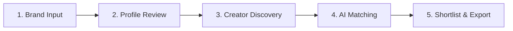

# Convert Cake — AI TikTok KOL Matcher

**AI-powered TikTok Key Opinion Leader (KOL) discovery, brand analysis, and influencer matching platform tailored for the Thai market.**

[](https://nextjs.org/)
[](https://react.dev/)
[](https://www.typescriptlang.org/)
[](https://tailwindcss.com/)
[](https://vitest.dev/)
[](package.json)

---

## Assessment Submission Details

| Field                      | Detail                                                                                                           |
| :------------------------- | :--------------------------------------------------------------------------------------------------------------- |
| **Candidate Submission**   | Convert Cake AI Engineer Technical Assessment                                                                    |
| **GitHub Repository**      | [https://github.com/worapon888/convert-cake-kol-matcher](https://github.com/worapon888/convert-cake-kol-matcher) |
| **Loom Video Walkthrough** | `[Insert Loom Demo Video Link Here]` _(Placeholder for applicant recording)_                                     |
| **Primary Workflow**       | 5-Step Guided Onboarding (`/` to `/?step=5`)                                                                     |
| **Technical Test Bench**   | Offline Developer Test Bench at [`/dev`](http://localhost:3000/dev)                                              |

---

## Table of Contents

1. [Project Overview & Business Problem](#1-project-overview--business-problem)
2. [Tech Stack](#2-tech-stack)
3. [Prerequisites](#3-prerequisites)
4. [Quick Start — Installation & Run (Windows & POSIX)](#4-quick-start--installation--run-windows--posix)
5. [Environment Variables](#5-environment-variables)
6. [Demo Mode vs. Live Mode](#6-demo-mode-vs-live-mode)
7. [How to Use the Application](#7-how-to-use-the-application)
8. [System Architecture & Scoring Methodology](#8-system-architecture--scoring-methodology)
9. [Testing & Verification](#9-testing--verification)
10. [Known Limitations & Security Safeguards](#10-known-limitations--security-safeguards)
11. [Troubleshooting](#11-troubleshooting)
12. [Key Technical Decisions](#12-key-technical-decisions)

---

## 1. Project Overview & Business Problem

Marketing teams and agencies in Thailand face severe friction when matching brands to TikTok creators:

1. **Unstructured Brand Briefs:** Campaign managers typically start with just an external brand website or social link. They manually parse product positioning, target demographics, tone of voice, and relevant Thai search terms.
2. **Noisy Search Candidates:** Scraping results for popular keywords (e.g., `"รีวิวสกินแคร์"`, `"เซรั่มลดสิว"`) frequently mix genuine individual creators with official brand storefronts (e.g., `@remo.thailand`), multi-brand retail curators, creators explicitly refusing commercial collaborations (`"ไม่รับงานรีวิว"`), or non-Thai language creators.
3. **Vanity Metric Traps:** High follower counts or isolated viral video hits often deceive marketers, obscuring whether a creator consistently engages target buyers in the brand's niche.

**Convert Cake KOL Matcher** resolves these bottlenecks by combining:

- **SSRF-Protected Brand Profiling:** Ingests public websites to synthesize structured brand personas and Thai discovery keywords using OpenAI Structured Outputs.
- **Cost-Controlled TikTok Discovery:** Programmatically discovers active TikTok creators through Apify's Actor without expensive unconstrained scraping runs.
- **Hybrid Deterministic & Semantic Scoring:** Evaluates creators with a pure TypeScript deterministic qualification pipeline (filtering brand accounts and review refusals) combined with OpenAI-evaluated semantic content relevance.
- **Interactive Shortlisting & CSV Export:** Allows marketers to review scores, inspect cited video evidence, adjust candidate lists, and export clean campaign shortlists in one click.

---

## 2. Tech Stack

The application is built on modern, minimal, and battle-tested production tooling. It deliberately avoids unneeded infrastructure layers (no external SQL/NoSQL databases, Docker, or Redis instances are required; in-memory caching and browser session state handle all persistence):

| Layer                 | Technology                                                       | Version              | Purpose in Codebase                                                          |
| :-------------------- | :--------------------------------------------------------------- | :------------------- | :--------------------------------------------------------------------------- |
| **Framework**         | [Next.js](https://nextjs.org/)                                   | `16.4.3`             | App Router, Server-side API Routes (`/api/*`), Turbopack compiler            |
| **UI Library**        | [React](https://react.dev/)                                      | `19.3.0`             | Client components, responsive state management, and modern hooks             |
| **Styling**           | [Tailwind CSS](https://tailwindcss.com/)                         | `^4.0.0`             | Responsive layout, modern gradients, and micro-interactions                  |
| **Language**          | [TypeScript](https://www.typescriptlang.org/)                    | `^5.0.0`             | Strict type checking (`tsconfig.json` with strict mode enabled)              |
| **Validation**        | [Zod](https://zod.dev/)                                          | `^4.6.7`             | Runtime request/response schema parsing and OpenAI Structured Output schemas |
| **AI Evaluation**     | [OpenAI SDK](https://github.com/openai/openai-node)              | `^7.43.0`            | GPT-4o-mini client with native Structured Outputs via Responses API          |
| **Scraper Ingestion** | [Apify REST API](https://apify.com/)                             | REST v2              | Connects to `clockworks/tiktok-scraper` with strict runtime and billing caps |
| **Testing**           | [Vitest](https://vitest.dev/)                                    | `^5.0.5`             | Fast unit & integration test runner, fixture-based assertion suite           |
| **Code Quality**      | [ESLint](https://eslint.org/) & [Prettier](https://prettier.io/) | `^9.0.0` / `^3.9.10` | Code formatting, React Hook rule enforcement, and Husky pre-commit hooks     |
| **Package Manager**   | [pnpm](https://pnpm.io/)                                         | `10.24.0`            | Deterministic dependency resolution via Corepack                             |

---

## 3. Prerequisites

Before running the application, ensure the following tools are installed:

- **Git:** Version `2.30+`
- **Node.js:** Version `^20.0.0` or `^22.0.0` (Node.js 22 LTS is verified and recommended)
- **pnpm:** Version `10.24.0` (managed via Node.js Corepack)

### Activating pnpm via Corepack

Node.js comes bundled with Corepack. Enable it to ensure the exact specified pnpm version is used:

```bash
corepack enable
corepack prepare pnpm@10.24.0 --activate
```

Verify your environment:

```bash
node -v   # Should output v20.x or v22.x
pnpm -v   # Should output 10.24.0
```

---

## 4. Quick Start — Installation & Run (Windows & POSIX)

Follow these verified commands to clone, configure, and start the application locally:

### Using Bash / macOS / Linux / PowerShell:

```bash
# 1. Clone the repository
git clone https://github.com/worapon888/convert-cake-kol-matcher.git
cd convert-cake-kol-matcher

# 2. Enable Corepack and install dependencies
corepack enable
pnpm install

# 3. Create your local environment configuration file
cp .env.example .env.local

# 4. Start the development server
pnpm dev
```

### Using Windows Command Prompt (`cmd.exe`):

```cmd
git clone https://github.com/worapon888/convert-cake-kol-matcher.git
cd convert-cake-kol-matcher
corepack enable
pnpm install
copy .env.example .env.local
pnpm dev
```

Open your browser at:

- **Main Application (5-Step Onboarding):** [http://localhost:3000](http://localhost:3000)
- **Technical Test Bench (Offline Demo):** [http://localhost:3000/dev](http://localhost:3000/dev)

---

## 5. Environment Variables

All external service credentials reside strictly on the server side and are never bundled into client-side JavaScript. Only 3 variables are recognized and utilized by the application:

### `.env.example` Reference

```env
# =============================================================================
# Convert Cake KOL Matcher — Environment Configuration Template
# Copy this file to `.env.local` and add your credentials.
# Never commit `.env.local` or real API keys to version control.
# =============================================================================

# [Required for Live AI Analysis & KOL Matching — Steps 1 & 4]
# OpenAI API Key used by official `openai` SDK (Structured Outputs)
OPENAI_API_KEY=your_openai_api_key_here

# [Optional — OpenAI Model supporting Structured Outputs (default: gpt-4o-mini)]
OPENAI_MODEL=gpt-4o-mini

# [Required for Live TikTok Scraping — Step 3]
# Apify API Token for running `clockworks/tiktok-scraper`
APIFY_API_TOKEN=your_apify_api_token_here
```

### Variable Details & Security Enforcement

| Variable Name     | Required For            | Default Value | Purpose                                                                                 |
| :---------------- | :---------------------- | :------------ | :-------------------------------------------------------------------------------------- |
| `OPENAI_API_KEY`  | Live Mode (Steps 1 & 4) | _None_        | Server-side key for analyzing brand website text and scoring creator content relevance. |
| `OPENAI_MODEL`    | Live Mode (Steps 1 & 4) | `gpt-4o-mini` | Specifies the OpenAI model supporting Structured Outputs (`gpt-4o-mini` or `gpt-4o`).   |
| `APIFY_API_TOKEN` | Live Mode (Step 3)      | _None_        | Server-side token authorizing scraper execution on Apify Cloud.                         |

### Security Checklist

- `.env.local` is explicitly listed in `.gitignore` and is never committed to Git.
- API keys are accessed only in server-side API routes (`src/app/api/*`) and internal libraries (`src/lib/*`).
- No client component uses `NEXT_PUBLIC_` for secret tokens; client bundles contain zero credentials.
- Note: Variables not referenced by source code (such as unused fixture flags) are deliberately omitted.

---

## 6. Demo Mode vs. Live Mode

The repository supports both offline zero-cost evaluation and full live cloud execution. Please review the capabilities of each mode below:

### 6.1 Demo Mode (Offline Testing without API Keys)

Reviewers who do not provide `OPENAI_API_KEY` or `APIFY_API_TOKEN` can evaluate the system using the following entry points:

1. **Developer Test Bench (`/dev` — Full Offline Evaluation):**
   - Navigate to [http://localhost:3000/dev](http://localhost:3000/dev).
   - Click **"Load Controlled Fixture"** to populate a verified Thai brand profile (`brand-analyzer-fixture.json`).
   - In the **Step 4 KOL Matching** section, keep the execution mode set to **`fixture_mock`**.
   - Click **"Run Step 4 KOL Matching"**. The engine will execute deterministic qualification, apply mock semantic evaluations, and compute pure TypeScript scores (`50/20/20/10`) against local datasets—**0 external API calls, 0 USD spent**.
2. **Automated Unit Testing (`pnpm test`):**
   - Runs **107 unit tests** across all 5 screens, normalization algorithms, scoring formulas, and mock APIs completely offline without network calls.
3. **Step 3 Discovery Screen Fallback:**
   - In the main wizard (`/?step=3`), if `APIFY_API_TOKEN` is missing, the system catches the error and safely falls back to displaying the curated local dataset (`normalized-tiktok-fixture.json`), clearly labeling it with an offline preview notice.

> ⚠️ **Important Note on Main Wizard Offline Limits:**
> In the main 5-step wizard (`http://localhost:3000`), **Step 1 (Brand Analysis)** and **Step 4 (Live AI Matching)** call OpenAI Structured Outputs by design. If `OPENAI_API_KEY` is not provided in `.env.local`, Step 1 and Step 4 will display an explicit configuration error banner (`OPENAI_CONFIGURATION_ERROR`). To test the end-to-end matching algorithms completely offline without an API key, reviewers should use the **Developer Test Bench at [`/dev`](http://localhost:3000/dev)**.

### 6.2 Live Mode (Real Cloud Ingestion & AI Scoring)

When valid API keys are configured in `.env.local`:

1. **Step 1 Live Website Extraction:** Enter any live public URL (e.g., `https://herhyness-intl.com`). The server scrapes public body text (protected by SSRF validation) and calls OpenAI GPT-4o-mini to synthesize structured brand facts and suggested TikTok keywords.
2. **Step 3 Live Apify TikTok Scraping:**
   - The application automatically invokes `POST /api/discovery/search` with the brand's primary keyword.
   - Calls the Apify Actor `clockworks/tiktok-scraper` in the cloud.
   - **Strict Cost Caps:** Capped at **1 keyword per run**, **max 5 items**, **60s timeout**, **$0.50 USD hard billing cap**, and **paid media download add-ons disabled** (no video or cover binary downloads).
   - Results are cached in server memory for 1 hour and saved to browser session storage to prevent duplicate charges upon page refresh.
3. **Step 4 Live OpenAI KOL Matching:**
   - Evaluates up to 10 qualified creators using OpenAI Structured Outputs.
   - Synthesizes semantic fit, checks video ID evidence citations, and returns rationale notes.

---

## 7. How to Use the Application

The user experience follows a 5-step guided wizard:



### Step 1: Brand Input (`/?step=1`)

- Enter your public brand website URL (e.g., `https://herhyness-intl.com`).
- _Alternative:_ If the brand lacks a website, click **"Don't have a website"** to open a modal and submit a manual product/brand description.
- Click **"Analyze website →"** to trigger AI extraction. _(Requires `OPENAI_API_KEY`)_

### Step 2: Brand Profile Review (`/?step=2`)

- Review extracted brand persona: Brand Name, Industry, Tone of Voice, Target Market (Thailand), and Target Audience Description.
- Inspect and customize the **Suggested TikTok Search Keywords** chips (these drive the creator discovery stage).
- Click **"Confirm & Discover Creators →"** to proceed. _(Client-side state, no API call)_

### Step 3: TikTok Creator Discovery (`/?step=3`)

- The system triggers a live search using the primary brand keyword via Apify.
- Displays creator cards in a 3-column grid featuring follower counts, sampled video views, sample engagement rates (ER), and TikTok bios.
- Automatically flags account types: isolates official brand storefronts (`@remo.thailand`) and flags profiles needing manual review.
- Click **"Continue to matching →"** to transition directly to AI evaluation. _(Falls back to saved fixture if Apify token is missing)_

### Step 4: AI Matching & Ranking (`/?step=4`)

- Automatically initiates the matching pipeline for up to 10 qualified creators.
- Displays match scores (0–100%), overall recommendation tier (`Strong Match`, `Good Match`, `Moderate Match`, or `Needs Review`), and detailed radar breakdown.
- Click any creator card to inspect cited video evidence, reasoning rationale, and audit warnings.
- Select creators using checkboxes and click **"Continue to Shortlist →"**. _(Requires `OPENAI_API_KEY`)_

### Step 5: Creator Shortlist & CSV Export (`/?step=5`)

- Review final shortlisted candidates and review total estimated reach and average ER.
- Click **"Export Shortlist (CSV)"** to download `convert-cake-kol-shortlist.csv` formatted with creator usernames, profile URLs, match scores, qualification statuses, and performance metrics. _(Client-side generation, no API call)_

---

## 8. System Architecture & Scoring Methodology

### 8.1 End-to-End Pipeline

```
[Brand Input URL / Text]
         │
         ▼
[SSRF Validation & HTML Extraction] ──▶ [OpenAI Structured Outputs] ──▶ [BrandProfile]
                                                                               │
[TikTok Search via Apify] ──▶ [Data Normalizer] ──▶ [TikTokCreator Records] ───┘
                                                           │
                                                           ▼
                                      [Deterministic Creator Qualification]
                                            ├─ Excluded: Brand Accounts / Review Refusals
                                            └─ Eligible / Needs Review
                                                           │
                                                           ▼
                                      [OpenAI Content Relevance Evaluator]
                                      (Category Fit + Product Fit + Style Fit)
                                                           │
                                                           ▼
                                      [Pure TypeScript Weighted Scoring Engine]
                                      (50% Content + 20% Market + 20% ER + 10% Suitability)
                                                           │
                                                           ▼
                                      [Ranked Recommendations + Evidence Citations]
                                                           │
                                                           ▼
                                      [Shortlist & Client-Side CSV Export]
```

### 8.2 API Route Reference

- **`POST /api/brands/analyze`**: Accepts `{ websiteUrl, targetMarket }` or `{ manualDescription }`. Extracted web content is verified against private IP / SSRF ranges before passing to OpenAI GPT-4o-mini.
- **`POST /api/discovery/search`**: Accepts `{ keyword, confirmPaidRun: true }`. Runs Apify Actor `clockworks/tiktok-scraper` with cost controls or serves from in-memory cache.
- **`POST /api/matching/evaluate`**: Accepts `{ brandProfile, creators, executionMode }`. Executes deterministic qualification, invokes OpenAI for semantic content grading, and computes composite match scores.

### 8.3 Scoring Weights Breakdown

Final creator match scores (0–100) are computed deterministically in pure TypeScript (`src/lib/matching/scoring.ts`):

$$\text{Final Score} = 0.50 \times \text{Content Fit} + 0.20 \times \text{Market Fit} + 0.20 \times \text{Performance Fit} + 0.10 \times \text{Creator Suitability}$$

1. **Content Fit (50% Weight):**
   - Synthesized from OpenAI rubric: `0.40 * Category Relevance + 0.35 * Product Relevance + 0.25 * Content Style Fit`.
   - Requires valid video ID citation; fabricated references are flagged during audit.
2. **Market Fit (20% Weight):**
   - Assesses Thai language presence in video captions, Thai hashtags, and regional audience alignment.
3. **Performance Fit (20% Weight):**
   - Calculates Engagement Rate by Views: $(\text{Likes} + \text{Comments} + \text{Shares}) / \text{Views}$.
   - Evaluated against standard Thai TikTok benchmarks (Nano/Micro: 3–6%, Mid: 2–4%).
4. **Creator Suitability (10% Weight):**
   - Commercial openness: Checks for bio contact channels (`"ติดต่องาน"`, `"LINE"`, email).
   - Penalizes ambiguous brand affiliate accounts.

### 8.4 Single-Video Sample Safeguard

Because initial TikTok scraping ingests a limited post sample per creator (1–5 videos), treating a single post's metrics as representative of lifetime performance introduces statistical bias. The system enforces:

- An automatic **`0.75x` provisional confidence factor** on performance subscores when `isSingleVideoSample: true`.
- An explicit user-facing disclaimer: _"Single-video sample only: metrics reflect a single post and must not be presented as representative creator-level performance."_

---

## 9. Testing & Verification

The project includes strict verification scripts in `package.json`:

```bash
# 1. Check code formatting
pnpm format:check

# 2. Run static ESLint validation
pnpm lint

# 3. Verify TypeScript types strictly
pnpm typecheck

# 4. Run full unit test suite (107 tests, 100% offline, 0 cost)
pnpm test

# 5. Build production bundle (Turbopack + TypeScript checks)
pnpm build
```

### Live Integration Tests (`pnpm test:live`)

> ⚠️ **Cost Warning:** Running `pnpm test:live` sends actual requests to OpenAI and Apify and will incur small monetary charges against your account credits. Do not run in CI/CD environments.

```bash
pnpm test:live
```

---

## 10. Known Limitations & Security Safeguards

### Known Limitations

1. **Facebook Page Content Extraction:** Facebook / Meta public pages enforce aggressive anti-scraping walls and require user login. The extractor performs best-effort OpenGraph and meta tag scraping. When pages block automated fetch, the application alerts the user to provide a manual description.
2. **Sample-Based TikTok Metrics:** To keep discovery fast and cost-controlled, the scraper analyzes sampled recent videos rather than complete account histories.
3. **Absence of Native Audience Demographics:** Public TikTok web scraping does not return verified follower age, gender, or exact geographic distribution. Thai market relevance is inferred from text language, scripts, and hashtags.
4. **Decision-Support Nature:** Match scores represent algorithmic positioning indicators, not a commercial guarantee of campaign conversion.

### Security Safeguards

- **SSRF Protection (`src/lib/brand/ssrf.ts`):** Prohibits user-supplied brand URLs from resolving to internal IPs (`127.0.0.1`, `10.0.0.0/8`, `192.168.0.0/16`, cloud metadata endpoints `169.254.169.254`).
- **Billing Controls (`src/lib/apify/tiktok-scraper.ts`):** Hard ceiling of $0.50 USD and 5 items per run to prevent unbounded billing spikes.
- **Zero Client-Side Secret Leakage:** No API tokens are exposed in Next.js public bundles.

---

## 11. Troubleshooting

| Symptom                                | Cause                                                              | Solution                                                                                     |
| :------------------------------------- | :----------------------------------------------------------------- | :------------------------------------------------------------------------------------------- |
| **`pnpm: command not found`**          | Corepack is disabled on the host machine.                          | Run `corepack enable` then `corepack prepare pnpm@10.24.0 --activate`.                       |
| **`Node.js version mismatch`**         | Host is running Node `< 20`.                                       | Upgrade Node.js to version `20.x` or `22.x LTS` via `nvm` or official installer.             |
| **`OPENAI_CONFIGURATION_ERROR` (503)** | Missing or placeholder `OPENAI_API_KEY` in `.env.local`.           | Provide a valid OpenAI API key in `.env.local`, or test offline using the `/dev` test bench. |
| **`MISSING_APIFY_TOKEN` (400)**        | Missing `APIFY_API_TOKEN` in `.env.local`.                         | Add your Apify API token in `.env.local` or rely on the automatic fallback dataset.          |
| **`Port 3000 already in use`**         | Another process is occupying port 3000.                            | Run `pnpm dev -p 3001` to start on an alternative port.                                      |
| **`Apify Actor run failed: HTTP 400`** | `maxTotalChargeUsd` was set below Apify's minimum allowed ($0.50). | This is already fixed in the current repository codebase (`$0.50` default).                  |
| **`Facebook Page Data Unavailable`**   | Meta blocked automated scraping without active session cookies.    | Use the "Don't have a website" option on Step 1 to supply brand context manually.            |

---

## 12. Key Technical Decisions

1. **Separation of Deterministic Rules and AI Evaluation:**
   Language detection, account type classification (excluding brand stores like `@remo.thailand`), commercial availability detection (`"ไม่รับงานรีวิว"`), and score calculations are implemented as deterministic, auditable TypeScript code. The LLM is used strictly where it excels: semantic comprehension of creator content versus brand tone.
2. **OpenAI Structured Outputs with Native Zod Schemas:**
   Eliminates fragile JSON regex parsing or retries. All AI responses strictly conform to runtime Zod schemas.
3. **Stateless In-Memory & Session Architecture:**
   Avoids heavyweight database setup, allowing reviewers to clone and run the application in seconds without Docker or PostgreSQL migrations, while maintaining full user experience across browser sessions.
4. **Strict Cost & Rate Limit Governance:**
   Guards against accidental automated scraping loops, concurrent request spam, and duplicate charges using in-memory locks, 1-hour TTL caches, and Apify query-level billing limits.

---

_Authored for the Convert Cake AI Engineer Assessment submission._
