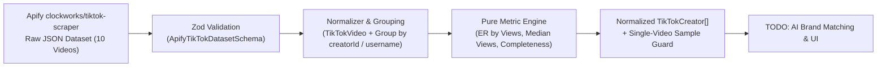

# Convert Cake KOL Matcher

**AI-powered TikTok KOL discovery, brand analysis, and influencer matching platform for the Thai market.**

> **Assessment Progress Notice (7-Day AI Engineer Assessment — Convert Cake)**
>
> - **Step 1 (Completed):** Project scaffold, Next.js App Router, strict TypeScript, ESLint, Prettier, Husky pre-commit hooks, and architecture/evaluation docs.
> - **Step 2 (Completed):** Real Apify (`clockworks/tiktok-scraper`) Zod schemas, data normalization (`TikTokVideo`, `TikTokCreator`, `CreatorMetrics`), pure metric calculation functions, fixture loaders, guarded Apify client module, and unit test suite (`18/18` passing).
> - **Pending (`TODO`):** Anthropic Claude integration, AI semantic scoring & ranking, and interactive Matcher UI have **not** been implemented yet.

---

## Table of Contents

1. [Project Overview & Business Problem](#1-project-overview--business-problem)
2. [Features & Implementation Status](#2-features--implementation-status)
3. [Technology Stack](#3-technology-stack)
4. [System Architecture & Data Flow](#4-system-architecture--data-flow)
5. [Actual Data Schema & Field Mapping (Step 2)](#5-actual-data-schema--field-mapping-step-2)
6. [Creator Metric Formulas & Data Quality Rules](#6-creator-metric-formulas--data-quality-rules)
7. [Dataset Limitations & Account Classification Rules](#7-dataset-limitations--account-classification-rules)
8. [Prerequisites & Installation Instructions](#8-prerequisites--installation-instructions)
9. [Environment Variable Configuration](#9-environment-variable-configuration)
10. [Local Development & Testing Commands](#10-local-development--testing-commands)
11. [Planned AI Analysis & KOL Matching Methodology (`TODO`)](#11-planned-ai-analysis--kol-matching-methodology-todo)
12. [API Integration & Guarded Apify Client](#12-api-integration--guarded-apify-client)
13. [Demo / Fixture Mode Documentation](#13-demo--fixture-mode-documentation)
14. [References & External Resources](#14-references--external-resources)

---

## 1. Project Overview & Business Problem

### Business Problem

Brands and agencies operating in Thailand's TikTok ecosystem face major bottlenecks when selecting Key Opinion Leaders (KOLs) for campaigns:

- **Single-Video & Vanity Metric Traps:** Follower counts and isolated viral posts frequently mask low median engagement or inconsistent view performance.
- **Language & Cultural Nuance:** Evaluating Thai creators requires handling Thai captions, hashtags (e.g., `#รีวิวสกินแคร์`), and distinguishing commercial/sponsored posts (`isAd`) and brand-owned storefronts from independent creators.
- **Data Sparsity & Incomplete Scrape Fields:** Third-party scrapers return nested, nullable fields without audience demographics, requiring strict validation and transparent data-completeness tracking.

### Solution Overview

**Convert Cake KOL Matcher** ingests real public TikTok dataset outputs from Apify (`clockworks/tiktok-scraper`), validates and normalizes them into strongly typed creator and video models, computes deterministic creator metrics with explicit sample-size warnings, and prepares structured inputs for downstream AI brand matching (`TODO`).

---

## 2. Features & Implementation Status

| Feature / Component                                      | Status        | Module / Location                                                                                      |
| -------------------------------------------------------- | ------------- | ------------------------------------------------------------------------------------------------------ |
| **Next.js App Router + TypeScript Strict Scaffold**      | `Implemented` | [`src/app/`](src/app/), [`tsconfig.json`](tsconfig.json)                                               |
| **Code Quality & Husky Pre-Commit Hooks**                | `Implemented` | [`.husky/pre-commit`](.husky/pre-commit), [`eslint.config.mjs`](eslint.config.mjs)                     |
| **Apify `clockworks/tiktok-scraper` Zod Schemas**        | `Implemented` | [`src/lib/tiktok/schemas.ts`](src/lib/tiktok/schemas.ts)                                               |
| **TikTok Video & Creator Normalization Pipeline**        | `Implemented` | [`src/lib/tiktok/normalizer.ts`](src/lib/tiktok/normalizer.ts)                                         |
| **Pure Creator Metric Functions**                        | `Implemented` | [`src/lib/tiktok/metrics.ts`](src/lib/tiktok/metrics.ts)                                               |
| **Real Apify Fixture Dataset & Loader Functions**        | `Implemented` | [`src/lib/tiktok/fixtures.ts`](src/lib/tiktok/fixtures.ts), [`src/data/fixtures/`](src/data/fixtures/) |
| **Reusable Apify Integration Client (Paid-Run Guarded)** | `Implemented` | [`src/lib/apify/tiktok-scraper.ts`](src/lib/apify/tiktok-scraper.ts)                                   |
| **Unit Tests for Normalization, Metrics & Guards**       | `Implemented` | [`tests/unit/tiktok-normalizer-metrics.test.ts`](tests/unit/tiktok-normalizer-metrics.test.ts)         |
| **Anthropic Claude Brand Analysis & Semantic Scoring**   | `TODO`        | Planned for Step 3                                                                                     |
| **Interactive KOL Matcher UI Dashboard**                 | `TODO`        | Planned for Step 4                                                                                     |

---

## 3. Technology Stack

| Layer                    | Technology                                                                                             | Version                      | Status        |
| ------------------------ | ------------------------------------------------------------------------------------------------------ | ---------------------------- | ------------- |
| **Framework**            | [Next.js](https://nextjs.org/) (App Router)                                                            | `16.4.3`                     | `Implemented` |
| **UI Library**           | [React](https://react.dev/)                                                                            | `19.3.0`                     | `Implemented` |
| **Language**             | [TypeScript](https://www.typescriptlang.org/) (`strict: true`)                                         | `5.9.3`                      | `Implemented` |
| **Schema Validation**    | [Zod](https://zod.dev/)                                                                                | `4.6.7`                      | `Implemented` |
| **Unit Testing**         | [Vitest](https://vitest.dev/)                                                                          | `5.0.5`                      | `Implemented` |
| **Styling**              | [Tailwind CSS](https://tailwindcss.com/)                                                               | `4.3.3`                      | `Implemented` |
| **Linting & Formatting** | [ESLint](https://eslint.org/) + [Prettier](https://prettier.io/)                                       | `9.x` / `3.9.x`              | `Implemented` |
| **Git Hooks**            | [Husky](https://typicode.github.io/husky/) + [lint-staged](https://github.com/lint-staged/lint-staged) | `9.1.7` / `17.6.0`           | `Implemented` |
| **Data Source Actor**    | Apify `clockworks/tiktok-scraper`                                                                      | REST API v2 + Local Fixtures | `Implemented` |
| **LLM Provider**         | Anthropic Claude API                                                                                   | —                            | `TODO`        |

---

## 4. System Architecture & Data Flow

See [`docs/architecture.md`](docs/architecture.md) for the full architectural specification.



---

## 5. Actual Data Schema & Field Mapping (Step 2)

### Field Mapping (`clockworks/tiktok-scraper` → Domain Models)

Implemented in [`src/lib/tiktok/schemas.ts`](src/lib/tiktok/schemas.ts) and [`src/lib/tiktok/normalizer.ts`](src/lib/tiktok/normalizer.ts):

| Apify Raw Field (`clockworks/tiktok-scraper`) | Normalized Field | Target Model                   | Type              | Fallback / Null Handling                                        |
| --------------------------------------------- | ---------------- | ------------------------------ | ----------------- | --------------------------------------------------------------- |
| `id`                                          | `videoId`        | `TikTokVideo`                  | `string`          | Coerced to trimmed string                                       |
| `text`                                        | `caption`        | `TikTokVideo`                  | `string \| null`  | Preserved as `null` if missing/empty                            |
| `webVideoUrl`                                 | `videoUrl`       | `TikTokVideo`                  | `string \| null`  | Preserved as `null` if missing/empty                            |
| `authorMeta.id`                               | `creatorId`      | `TikTokVideo`, `TikTokCreator` | `string`          | Falls back to `authorMeta.name` (`username`) when missing/empty |
| `authorMeta.name`                             | `username`       | `TikTokVideo`, `TikTokCreator` | `string`          | Required non-empty handle                                       |
| `authorMeta.profileUrl`                       | `profileUrl`     | `TikTokCreator`                | `string \| null`  | Preserved as `null` if missing                                  |
| `authorMeta.fans`                             | `followers`      | `TikTokCreator`                | `number \| null`  | Preserved as `null` if missing (never `0` by default)           |
| `playCount`                                   | `views`          | `TikTokVideo`                  | `number \| null`  | Preserved as `null` if missing                                  |
| `diggCount`                                   | `likes`          | `TikTokVideo`                  | `number \| null`  | Preserved as `null` if missing                                  |
| `commentCount`                                | `comments`       | `TikTokVideo`                  | `number \| null`  | Preserved as `null` if missing                                  |
| `shareCount`                                  | `shares`         | `TikTokVideo`                  | `number \| null`  | Preserved as `null` if missing                                  |
| `createTimeISO`                               | `publishedAt`    | `TikTokVideo`                  | `string \| null`  | ISO-8601 timestamp or `null`                                    |
| `hashtags[].name`                             | `hashtags`       | `TikTokVideo`                  | `string[]`        | Filtered array of non-empty hashtag names                       |
| `isAd`                                        | `isAd`           | `TikTokVideo`                  | `boolean \| null` | Preserved for commercial/ad disclosure analysis                 |

### Normalized TypeScript Interfaces

```ts
export interface TikTokVideo {
  videoId: string;
  creatorId: string;
  username: string;
  caption: string | null;
  videoUrl: string | null;
  views: number | null;
  likes: number | null;
  comments: number | null;
  shares: number | null;
  publishedAt: string | null;
  hashtags: string[];
  isAd: boolean | null;
  isSponsored: boolean | null;
  textLanguage: string | null;
  engagementRateByViews: number | null;
}

export interface CreatorMetrics {
  sampledVideosCount: number;
  medianViews: number | null;
  averageEngagementRate: number | null;
  engagementRatesByVideo: (number | null)[];
  dataCompleteness: number; // [0, 1]
  missingFields: string[];
  isSingleVideoSample: boolean;
  isRepresentativeCreatorPerformance: boolean;
  sampleRepresentativenessNote: string;
  adVideosCount: number;
}

export interface TikTokCreator {
  creatorId: string;
  usedUsernameFallbackForId: boolean;
  username: string;
  nickname: string | null;
  profileUrl: string | null;
  followers: number | null;
  bio: string | null;
  verified: boolean | null;
  accountTypeReviewStatus: "unverified" | "creator" | "brand";
  audienceDemographics: null; // Never invented
  videos: TikTokVideo[];
  metrics: CreatorMetrics;
}
```

---

## 6. Creator Metric Formulas & Data Quality Rules

Implemented as pure TypeScript functions in [`src/lib/tiktok/metrics.ts`](src/lib/tiktok/metrics.ts):

### 1. Engagement Rate by Views (`calculateEngagementRateByViews`)

$$\text{ER}_{\text{video}} = \frac{\text{likes} + \text{comments} + \text{shares}}{\text{views}}$$

- Returns `null` if any of `views`, `likes`, `comments`, or `shares` is `null` or if `views <= 0`.

### 2. Median Views (`calculateMedianViews`)

- Filters sampled videos with non-null finite `views` and sorts ascending ($v_1 \le v_2 \le \dots \le v_n$):
  - If $n = 0$: returns `null`
  - If $n$ is odd: returns $v_{\lfloor n/2 \rfloor + 1}$
  - If $n$ is even: returns $\frac{v_{n/2} + v_{n/2 + 1}}{2}$

### 3. Average Engagement Rate (`calculateAverageEngagementRate`)

$$\overline{\text{ER}} = \frac{1}{k} \sum_{i=1}^{k} \text{ER}_{\text{video}, i}$$

- Computed over the $k$ sampled videos that have a non-null $\text{ER}_{\text{video}}$. Returns `null` when $k = 0$.

### 4. Number of Sampled Videos (`calculateSampledVideoCount`)

$$N_{\text{sampled}} = \text{videos.length}$$

### 5. Data Completeness (`calculateDataCompleteness`)

$$\text{DataCompleteness} = \frac{\text{presentFieldsCount}}{4 + 9 \cdot \max(N_{\text{sampled}}, 1)}$$

- Evaluates the **4 core creator fields** (`creatorId`, `username`, `profileUrl`, `followers`) plus **9 core video fields per sampled video** (`videoId`, `caption`, `videoUrl`, `views`, `likes`, `comments`, `shares`, `publishedAt`, `hashtags`).
- Returns a normalized ratio in `[0, 1]` and an explicit `missingFields` array.

---

## 7. Dataset Limitations & Account Classification Rules

1. **10 Videos from 10 Unique Creators (Single-Video Sample Limitation):**
   - The primary fixture ([`src/data/fixtures/apify-tiktok-raw.json`](src/data/fixtures/apify-tiktok-raw.json), search query `"รีวิวสกินแคร์"`) contains **10 videos across 10 unique creators** (`1` video per creator).
   - Because each creator currently has only 1 sampled video (`sampledVideosCount === 1`), `isSingleVideoSample` is `true` and `isRepresentativeCreatorPerformance` is `false` (requires `>= 3` videos).
   - **Rule:** Single-video metrics reflect an individual post and must **never** be presented as representative creator-level performance.
2. **No Invented Audience Demographics:**
   - Public `clockworks/tiktok-scraper` outputs do not contain follower age, gender, or geographic breakdowns. `audienceDemographics` is strictly preserved as `null`.
3. **Preserving `isAd` vs. Brand/Creator Account Classification:**
   - Each video preserves `isAd` (`boolean | null`) for commercial content analysis.
   - However, `isAd` does **not** determine whether an account is a brand-owned storefront or an individual creator (e.g., individual creators post sponsored content with `isAd: true`, and official brand accounts such as `etudethailand` or `hyaserum_official` can post organic videos with `isAd: false`).
   - All creators default to `accountTypeReviewStatus: "unverified"` and support explicit manual review overrides (`"creator"` vs. `"brand"`).

---

## 8. Prerequisites & Installation Instructions

### Prerequisites

- **Node.js:** `>= 22.x`
- **pnpm:** `>= 10.x`
- **Git:** `>= 2.x`

### Installation

```bash
git clone https://github.com/worapon888/convert-cake-kol-matcher.git
cd convert-cake-kol-matcher
pnpm install
cp .env.example .env.local
```

---

## 9. Environment Variable Configuration

Copy [`.env.example`](.env.example) to `.env.local`. **Never commit `.env.local` or real API keys.**

| Variable                   | Required                        | Default | Description                                                      | Status                 |
| -------------------------- | ------------------------------- | ------- | ---------------------------------------------------------------- | ---------------------- |
| `ANTHROPIC_API_KEY`        | Required for Live AI Mode       | —       | Anthropic API key for Claude brand analysis and KOL matching     | `TODO (Step 3)`        |
| `APIFY_API_TOKEN`          | Optional (Fixture Mode Default) | —       | Apify API token for `clockworks/tiktok-scraper` dataset fetching | `Guarded Client Ready` |
| `NEXT_PUBLIC_USE_FIXTURES` | Optional                        | `true`  | Uses local Apify TikTok fixtures without paid API runs           | `Implemented`          |

---

## 10. Local Development & Testing Commands

| Command             | Description                                                            |
| ------------------- | ---------------------------------------------------------------------- |
| `pnpm test`         | Run Vitest unit tests (`tests/unit/tiktok-normalizer-metrics.test.ts`) |
| `pnpm test:watch`   | Run Vitest in interactive watch mode                                   |
| `pnpm lint`         | Run ESLint static analysis                                             |
| `pnpm typecheck`    | Run TypeScript strict compiler validation (`tsc --noEmit`)             |
| `pnpm format:check` | Verify code formatting with Prettier                                   |
| `pnpm dev`          | Start Next.js development server                                       |
| `pnpm build`        | Build production Next.js bundle                                        |

### Running Verification Suite

```bash
pnpm lint
pnpm typecheck
pnpm test
```

---

## 11. Planned AI Analysis & KOL Matching Methodology (`TODO`)

> **Status:** `TODO` — Claude integration and AI scoring are **not yet implemented**.

In upcoming steps, normalized `TikTokCreator` profiles and `CreatorMetrics` will be combined with brand brief analysis to evaluate niche fit, content style, and campaign suitability while respecting single-video sample warnings.

---

## 12. API Integration & Guarded Apify Client

Implemented in [`src/lib/apify/tiktok-scraper.ts`](src/lib/apify/tiktok-scraper.ts):

- **Actor:** `clockworks/tiktok-scraper`
- **Paid-Run Protection (`ApifyPaidRunGuardError`):** Calling `runClockworksTikTokScraper()` blocks execution by default unless `{ allowPaidActorRun: true }` is explicitly passed, preventing accidental paid Actor runs during development, testing, or review.
- **Dataset Fetching (`fetchApifyDatasetById`):** Fetches items from an existing Apify dataset ID and normalizes them through `normalizeApifyDataset()`.

---

## 13. Demo / Fixture Mode Documentation

Implemented in [`src/lib/tiktok/fixtures.ts`](src/lib/tiktok/fixtures.ts):

- `loadRawApifyFixture("primary" | "batch2")`: Loads and Zod-validates the real 10-video raw Apify JSON datasets in [`src/data/fixtures/`](src/data/fixtures/).
- `normalizeRawApifyFixture("primary" | "batch2")`: Runs the full normalization and creator metrics pipeline on the raw fixture.
- `loadNormalizedTikTokFixture()`: Loads and Zod-validates [`src/data/fixtures/normalized-tiktok-fixture.json`](src/data/fixtures/normalized-tiktok-fixture.json).

---

## 14. References & External Resources

- [Apify `clockworks/tiktok-scraper` Actor](https://apify.com/clockworks/tiktok-scraper)
- [Zod Documentation](https://zod.dev/)
- [Vitest Documentation](https://vitest.dev/)
- [Next.js App Router Documentation](https://nextjs.org/docs/app)
- [Architecture Specification (`docs/architecture.md`)](docs/architecture.md)
- [Evaluation & Testing Strategy (`docs/evaluation.md`)](docs/evaluation.md)
