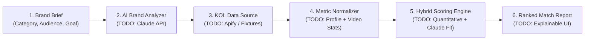

# Convert Cake KOL Matcher

**AI-powered TikTok KOL discovery, brand analysis, and influencer matching platform for the Thai market.**

> **Assessment Status Notice (7-Day AI Engineer Assessment — Convert Cake)**  
> This repository currently contains the **project foundation, development tooling, strict TypeScript/linting configuration, Git hooks, and system design documentation**.  
> Business features—including Anthropic Claude AI integration, Apify TikTok data collection, the hybrid scoring engine, and interactive UI workflows—are **not yet implemented** and are explicitly marked as `TODO` / `Planned` throughout this documentation.

---

## Table of Contents

1. [Project Overview & Business Problem](#1-project-overview--business-problem)
2. [Features & Scope of the MVP](#2-features--scope-of-the-mvp)
3. [Technology Stack](#3-technology-stack)
4. [System Architecture & Data Flow](#4-system-architecture--data-flow)
5. [Prerequisites & Installation Instructions](#5-prerequisites--installation-instructions)
6. [Environment Variable Configuration](#6-environment-variable-configuration)
7. [Local Development Commands](#7-local-development-commands)
8. [AI Analysis & KOL Matching Methodology](#8-ai-analysis--kol-matching-methodology)
9. [Scoring Algorithm Explanation](#9-scoring-algorithm-explanation)
10. [API Integration Overview](#10-api-integration-overview)
11. [Demo / Fixture Mode Documentation](#11-demo--fixture-mode-documentation)
12. [Known Limitations, Platform Access Constraints & Privacy Considerations](#12-known-limitations-platform-access-constraints--privacy-considerations)
13. [Testing & Evaluation Instructions](#13-testing--evaluation-instructions)
14. [References & External Resources](#14-references--external-resources)

---

## 1. Project Overview & Business Problem

### Business Problem

Brands and agencies operating in Thailand's fast-moving TikTok ecosystem face major bottlenecks when selecting Key Opinion Leaders (KOLs) for campaigns:

- **Vanity Metric Traps:** Follower counts and single viral videos frequently mask low median engagement or inconsistent view velocity.
- **Language & Cultural Nuance:** Discovering and evaluating Thai creators requires understanding Thai captions, slang, local hashtags (e.g., `#รีวิวบิวตี้`, `#ป้ายยา`, `#คาเฟ่กรุงเทพ`), and TikTok Shop conversion signals.
- **Manual Screening Overhead:** Marketing teams spend hours manually cross-checking creator bios, recent videos, and engagement rates against a campaign brief.

### Solution Overview

**Convert Cake KOL Matcher** is designed to automate and standardize Thai TikTok KOL discovery and evaluation. Given a structured or free-text brand brief, the platform plans to:

1. Analyze the brand's product positioning, target audience, and campaign goals using **Anthropic Claude** (`TODO`).
2. Discover candidate Thai TikTok creators via **Apify** or a deterministic **local fixture dataset** (`TODO`).
3. Score and rank candidates using a transparent **hybrid quantitative + qualitative scoring engine** (`TODO`).
4. Present explainable match rationales, score breakdowns, and recommended creative angles for each KOL (`TODO`).

---

## 2. Features & Scope of the MVP

| Feature / Component                                 | Status        | Description                                                                                                              |
| --------------------------------------------------- | ------------- | ------------------------------------------------------------------------------------------------------------------------ |
| **Next.js App Router + TypeScript Strict Scaffold** | `Implemented` | Project structure, strict compiler configuration, Tailwind CSS v4                                                        |
| **Code Quality & Husky Pre-Commit Hooks**           | `Implemented` | ESLint, Prettier, and `lint-staged` enforced automatically on `git commit`                                               |
| **Architecture & Evaluation Documentation**         | `Implemented` | Detailed specifications in [`docs/architecture.md`](docs/architecture.md) and [`docs/evaluation.md`](docs/evaluation.md) |
| **Brand Brief Input & AI Brand Analyzer**           | `TODO`        | Parse brand category, target persona, tone, and campaign goals into search criteria                                      |
| **TikTok Creator Discovery (Apify + Fixture Mode)** | `TODO`        | Retrieve Thai TikTok creator profiles and recent video metrics via Apify or local fixtures                               |
| **Hybrid Quantitative + AI Scoring Engine**         | `TODO`        | Compute composite `0–100` match scores across 4 weighted dimensions                                                      |
| **Explainable KOL Match Dashboard**                 | `TODO`        | Ranked creator cards with score breakdown, rationale, and outreach/content suggestions                                   |
| **Automated Unit & Benchmark Evaluation Suite**     | `TODO`        | Unit tests for scoring edge cases and benchmark evaluation in [`tests/`](tests/)                                         |

---

## 3. Technology Stack

| Layer                    | Technology                                                                                             | Version / Notes                          | Status           |
| ------------------------ | ------------------------------------------------------------------------------------------------------ | ---------------------------------------- | ---------------- |
| **Framework**            | [Next.js](https://nextjs.org/) (App Router)                                                            | `16.4.3`                                 | `Implemented`    |
| **UI Library**           | [React](https://react.dev/)                                                                            | `19.3.0`                                 | `Implemented`    |
| **Language**             | [TypeScript](https://www.typescriptlang.org/)                                                          | `5.9.3` (`strict: true`)                 | `Implemented`    |
| **Styling**              | [Tailwind CSS](https://tailwindcss.com/)                                                               | `4.3.3`                                  | `Implemented`    |
| **Linting & Formatting** | [ESLint](https://eslint.org/) + [Prettier](https://prettier.io/)                                       | ESLint `9.x` + Prettier `3.9.x`          | `Implemented`    |
| **Git Hooks**            | [Husky](https://typicode.github.io/husky/) + [lint-staged](https://github.com/lint-staged/lint-staged) | Husky `9.1.7` + lint-staged `17.6.0`     | `Implemented`    |
| **Package Manager**      | [pnpm](https://pnpm.io/)                                                                               | `10.24.0`                                | `Implemented`    |
| **LLM Provider**         | [Anthropic Claude API](https://docs.anthropic.com/)                                                    | Brand analysis & semantic KOL evaluation | `TODO (Planned)` |
| **Data Collection**      | [Apify Platform](https://apify.com/)                                                                   | TikTok profile & video metadata actors   | `TODO (Planned)` |

---

## 4. System Architecture & Data Flow

See [`docs/architecture.md`](docs/architecture.md) for the full architectural specification.



### Planned Data Pipeline (`TODO`)

1. **Brief Ingestion (`TODO`):** User submits a brand profile (e.g., Thai skincare brand targeting Gen Z women on TikTok Shop) or selects a preset sample brief.
2. **AI Criteria Extraction (`TODO`):** Claude extracts relevant Thai/English hashtags, niche keywords, target follower tiers, and scoring weights.
3. **Candidate Retrieval (`TODO`):** System fetches candidate TikTok profiles and their latest videos either from **Apify** (live mode) or **curated local fixtures** (demo/fixture mode).
4. **Normalization & Quantitative Scoring (`TODO`):** Raw metrics (followers, views, likes, comments, shares, posting timestamps) are normalized into deterministic sub-scores.
5. **Semantic Fit & Explanation (`TODO`):** Claude evaluates top candidates' bios and recent video captions against the brand brief and produces structured match rationales.
6. **Composite Ranking (`TODO`):** Quantitative and qualitative scores are combined into a final `0–100` match score and rendered in the UI.

---

## 5. Prerequisites & Installation Instructions

### Prerequisites

- **Node.js:** `>= 20.x` (verified with `v22.19.0`)
- **pnpm:** `>= 10.x` (verified with `10.24.0`)
- **Git:** `>= 2.x`

### Installation

1. **Clone the repository:**

   ```bash
   git clone https://github.com/worapon888/convert-cake-kol-matcher.git
   cd convert-cake-kol-matcher
   ```

2. **Install dependencies:**

   ```bash
   pnpm install
   ```

   > Running `pnpm install` automatically executes the `prepare` script (`husky`), activating the `.husky/pre-commit` hook.

3. **Configure environment variables:**

   ```bash
   cp .env.example .env.local
   ```

4. **Start the development server:**

   ```bash
   pnpm dev
   ```

   Open `http://localhost:3000` in your browser.

---

## 6. Environment Variable Configuration

Copy [`.env.example`](.env.example) to `.env.local` for local development. **Never commit `.env.local` or real credentials.**

| Variable                   | Required                        | Default | Description                                                      | Status                       |
| -------------------------- | ------------------------------- | ------- | ---------------------------------------------------------------- | ---------------------------- |
| `ANTHROPIC_API_KEY`        | Required for Live AI Mode       | —       | Anthropic API key for Claude brand analysis and KOL matching     | `TODO (Integration Pending)` |
| `APIFY_API_TOKEN`          | Required for Live Scraping Mode | —       | Apify API token for TikTok profile and video data collection     | `TODO (Integration Pending)` |
| `NEXT_PUBLIC_USE_FIXTURES` | Optional                        | `true`  | Enables deterministic fixture/demo mode without live Apify calls | `TODO (Integration Pending)` |

---

## 7. Local Development Commands

| Command             | Description                                         | Status    |
| ------------------- | --------------------------------------------------- | --------- |
| `pnpm dev`          | Start the Next.js development server with Turbopack | `Working` |
| `pnpm build`        | Build the production Next.js application            | `Working` |
| `pnpm start`        | Start the production Next.js server                 | `Working` |
| `pnpm lint`         | Run ESLint across the repository                    | `Working` |
| `pnpm lint:fix`     | Run ESLint with automatic fixes                     | `Working` |
| `pnpm typecheck`    | Run TypeScript compiler validation (`tsc --noEmit`) | `Working` |
| `pnpm format`       | Format all repository files using Prettier          | `Working` |
| `pnpm format:check` | Verify formatting across all files using Prettier   | `Working` |

---

## 8. AI Analysis & KOL Matching Methodology

> **Note:** This section describes the **planned (`TODO`)** AI methodology to be implemented during the assessment.

### Stage 1: Brand Brief Decomposition (`TODO`)

Instead of matching raw user text directly against creator profiles, Claude will first transform the brand input into a structured `BrandAnalysisProfile`:

- **Core Niche & Sub-verticals:** e.g., `Beauty > Skincare > Acne & Sensitive Skin`
- **Search Keywords & Thai Hashtags:** e.g., `#สกินแคร์ลดสิว`, `#รีวิวบิวตี้`, `#ป้ายยาสกินแคร์`
- **Target Audience Persona:** Demographics, language style (casual Gen Z Thai, expert/dermatology tone, lifestyle)
- **Recommended KOL Tier:** Nano (`1K–10K`), Micro (`10K–100K`), Macro (`100K–1M`), or Mega (`1M+`)

### Stage 2: Candidate Filtering & Quantitative Pre-Scoring (`TODO`)

Before invoking LLM evaluation on individual creators, candidates are filtered and scored deterministically on engagement and consistency metrics to minimize token usage and prevent LLM hallucination over numerical calculations.

### Stage 3: Semantic Fit & Explainable Rationale Generation (`TODO`)

For candidate KOLs, Claude receives the structured brand profile alongside the creator's normalized bio, top hashtags, recent video captions, and pre-calculated quantitative metrics, returning a structured JSON evaluation:

- `nicheAlignmentScore` (`0–100`)
- `toneAndStyleFitScore` (`0–100`)
- `matchSummary` (concise explanation of why the creator fits)
- `recommendedContentAngle` (specific TikTok video hook/format suggestion)
- `risksOrConsiderations` (e.g., competitor mentions, low comment depth)

---

## 9. Scoring Algorithm Explanation

> **Note:** The scoring engine is **planned (`TODO`)** and not yet implemented in code.

The final **Composite Match Score (`0–100`)** is a weighted sum of four normalized sub-scores:

$$\text{CompositeScore} = 0.35 \cdot S_{\text{align}} + 0.30 \cdot S_{\text{engage}} + 0.20 \cdot S_{\text{consist}} + 0.15 \cdot S_{\text{market}}$$

### Sub-Score Breakdown

1. **Brand & Niche Alignment ($S\_{\text{align}}$, Weight: `35%` — AI Semantic Score, `TODO`):**
   - Evaluates topical overlap between the brand's product/category and the creator's recent video captions, hashtags, and bio.
   - Evaluates content presentation style (e.g., hands-on product review, storytelling, vlog, comedy) against campaign goals.

2. **Engagement Quality ($S\_{\text{engage}}$, Weight: `30%` — Quantitative, `TODO`):**
   - Uses **median video engagement rate** across recent videos rather than mean to avoid distortion from a single viral outlier:
     $$\text{ER}_{\text{video}} = \frac{\text{Likes} + \text{Comments} + \text{Shares}}{\max(\text{Views}, 1)}$$
   - Applies higher weight to comments and shares when the campaign objective is conversion/consideration.

3. **Consistency & Momentum ($S\_{\text{consist}}$, Weight: `20%` — Quantitative, `TODO`):**
   - Measures posting cadence (videos per week over the last 30–60 days).
   - Measures view stability via the ratio of median views to followers and interquartile view consistency.

4. **Audience & Market Fit ($S\_{\text{market}}$, Weight: `15%` — Hybrid, `TODO`):**
   - Verifies Thai language/location signals (`TH` region, Thai script ratio in captions/comments).
   - Evaluates follower tier alignment with the brand's target budget tier.

---

## 10. API Integration Overview

> **Note:** External API clients are **not yet implemented (`TODO`)**.

### Anthropic Claude API (`TODO`)

- **Purpose:** Structured brand brief analysis and per-creator semantic fit evaluation.
- **Authentication:** Server-side `ANTHROPIC_API_KEY` header.
- **Planned Guardrails:** Strict JSON schema validation, deterministic temperature (`0.1–0.2`), request timeouts, and token usage logging.

### Apify TikTok Scraper API (`TODO`)

- **Purpose:** On-demand collection of public TikTok creator profiles and recent video metrics by hashtag, keyword, or handle.
- **Authentication:** Server-side `APIFY_API_TOKEN`.
- **Planned Guardrails:** Configurable max results per run to control latency and Apify compute unit consumption, caching of fetched profiles, and automatic fallback to local fixtures.

---

## 11. Demo / Fixture Mode Documentation

> **Status:** `Planned (TODO)`

To ensure technical reviewers can run, test, and evaluate the full application immediately—even without an active Apify subscription, live TikTok scraping wait times, or API credits—the project is architected with a first-class **Demo / Fixture Mode** (`TODO`):

- **How it will work (`TODO`):**
  - When `NEXT_PUBLIC_USE_FIXTURES=true` (or via an in-app toggle), the ingestion layer loads a curated dataset of realistic Thai TikTok KOL profiles across key categories (Beauty/Skincare, Food & Beverage, Fashion, Tech/Gadgets, Lifestyle).
  - Pre-computed AI analysis fixtures will also be provided if `ANTHROPIC_API_KEY` is not configured, while allowing live Claude evaluation over fixture KOLs when `ANTHROPIC_API_KEY` is present.

---

## 12. Known Limitations, Platform Access Constraints & Privacy Considerations

### Platform Access Constraints

- **TikTok Anti-Scraping & Rate Limits:** Live TikTok scraping via third-party actors (Apify) can experience variable latency (15–60+ seconds per actor run), CAPTCHA challenges, or schema changes on TikTok's public web endpoints.
- **No Private Creator Analytics:** Without first-party TikTok Creator Marketplace OAuth authorization from each creator, audience demographics (exact follower age/gender/province breakdown) and TikTok Shop GMV are not publicly accessible. The system relies on public proxy signals (caption language, engagement ratios, content topics).

### Known MVP Limitations

- **Current Implementation State:** Only the repository scaffold, tooling, and documentation are completed at this stage; application logic is `TODO`.
- **Sample Size per Creator:** Live scraping inspects a bounded window of recent public videos (e.g., latest 10–20 videos) rather than full historical archives to keep latency practical.
- **Static Snapshot:** Metrics represent a point-in-time snapshot unless refreshed.

### Privacy & Compliance Considerations

- **Public Data Only:** The system is designed to process only publicly visible creator profile fields and public video metadata.
- **No Credential Exposure:** All third-party API keys (`ANTHROPIC_API_KEY`, `APIFY_API_TOKEN`) remain strictly server-side and are excluded from Git via [`.gitignore`](.gitignore).

---

## 13. Testing & Evaluation Instructions

See [`docs/evaluation.md`](docs/evaluation.md) and [`tests/README.md`](tests/README.md) for the complete testing and evaluation plan.

### Currently Available Quality Checks (`Implemented`)

Run the following commands to verify code quality, TypeScript strict compliance, and formatting:

```bash
# 1. Run ESLint
pnpm lint

# 2. Run TypeScript strict type-checking
pnpm typecheck

# 3. Verify Prettier code formatting
pnpm format:check
```

### Pre-Commit Hook Verification (`Implemented`)

Husky is configured in [`.husky/pre-commit`](.husky/pre-commit) to run `pnpm exec lint-staged` on every commit, executing:

- `eslint --fix` and `prettier --write` on staged `*.{js,jsx,ts,tsx,mjs,cjs}` files
- `prettier --write` on staged `*.{json,md,css,scss,yml,yaml}` files

### Planned Automated Tests & Evaluation (`TODO`)

- `TODO`: Unit test suite (`tests/unit/`) for scoring formulas, normalization, and edge cases.
- `TODO`: Integration test suite (`tests/integration/`) for fixture pipeline and schema validation.
- `TODO`: Offline benchmark evaluation (`tests/evaluation/`) comparing model rankings against reference Thai brand briefs.

---

## 14. References & External Resources

- [Next.js App Router Documentation](https://nextjs.org/docs/app)
- [Anthropic Claude API Documentation](https://docs.anthropic.com/)
- [Apify Platform & Store Documentation](https://docs.apify.com/)
- [Tailwind CSS v4 Documentation](https://tailwindcss.com/docs)
- [Husky Git Hooks Documentation](https://typicode.github.io/husky/)
- [Project Architecture Specification (`docs/architecture.md`)](docs/architecture.md)
- [Evaluation & Testing Strategy (`docs/evaluation.md`)](docs/evaluation.md)
