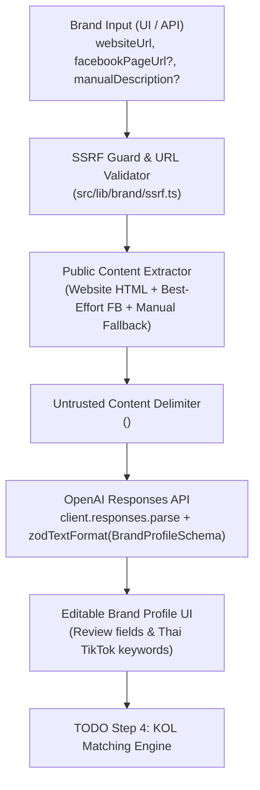

# Convert Cake KOL Matcher

**AI-powered TikTok KOL discovery, brand analysis, and influencer matching platform for the Thai market.**

> **Assessment Progress Notice (7-Day AI Engineer Assessment — Convert Cake)**
>
> - **Step 1 (Completed):** Project scaffold, Next.js App Router, strict TypeScript, ESLint, Prettier, Husky pre-commit hooks, and architecture/evaluation docs.
> - **Step 2 (Completed):** Real Apify (`clockworks/tiktok-scraper`) Zod schemas, data normalization (`TikTokVideo`, `TikTokCreator`, `CreatorMetrics`), pure metric calculation functions, fixture loaders, guarded Apify client module, and unit tests.
> - **Step 3 (Completed):** AI Brand Analyzer with SSRF-protected website content extraction, best-effort Facebook Page extraction, manual description fallback, OpenAI Responses API + Structured Outputs (`BrandProfileSchema`), `POST /api/brands/analyze` endpoint, minimal editable Brand Profile test UI, and unit tests.
> - **Pending (`TODO`):** TikTok KOL Matching engine, composite ranking, and final recommendation UI (Step 4) are **not** implemented yet.

---

## Table of Contents

1. [Project Overview & Business Problem](#1-project-overview--business-problem)
2. [Features & Implementation Status](#2-features--implementation-status)
3. [Technology Stack](#3-technology-stack)
4. [System Architecture & Data Flow](#4-system-architecture--data-flow)
5. [Step 3 — AI Brand Analyzer Architecture & Schema](#5-step-3--ai-brand-analyzer-architecture--schema)
6. [Step 2 — TikTok Data Schema, Field Mapping & Metric Formulas](#6-step-2--tiktok-data-schema-field-mapping--metric-formulas)
7. [Prerequisites & Installation Instructions](#7-prerequisites--installation-instructions)
8. [Environment Variable Configuration](#8-environment-variable-configuration)
9. [Local Development & Testing Commands](#9-local-development--testing-commands)
10. [Manual Integration Test Procedure (Controlled Live Test)](#10-manual-integration-test-procedure-controlled-live-test)
11. [Security Considerations, Facebook Extraction & Dataset Limitations](#11-security-considerations-facebook-extraction--dataset-limitations)
12. [References & External Resources](#12-references--external-resources)

---

## 1. Project Overview & Business Problem

Brands and agencies operating in Thailand's TikTok ecosystem face major bottlenecks when selecting Key Opinion Leaders (KOLs):

- **Unstructured Brand Briefs:** Marketing teams often start with only a brand URL or rough product page and need structured campaign criteria and focused Thai TikTok discovery keywords.
- **Single-Video & Vanity Metric Traps:** Follower counts and isolated viral posts frequently mask low median engagement or inconsistent view performance.
- **Incomplete Public Scrape Data:** Third-party scrapers return nested, nullable fields without audience demographics, while social platforms like Facebook restrict unauthenticated scraping.

**Convert Cake KOL Matcher** solves this through a transparent, step-by-step pipeline:

1. **AI Brand Analyzer (Step 3 — Implemented):** Extracts public signals from a business website (plus best-effort Facebook metadata or manual description fallback) and uses **OpenAI Responses API with Structured Outputs** to generate an editable `BrandProfile` separating observed source facts from inferred recommendations.
2. **TikTok Data Normalization & Creator Metrics (Step 2 — Implemented):** Validates and normalizes Apify `clockworks/tiktok-scraper` datasets into `TikTokVideo`, `TikTokCreator`, and `CreatorMetrics` with explicit single-video sample guards.
3. **KOL Matching & Ranking Engine (Step 4 — `TODO`):** Matches the reviewed `BrandProfile` against candidate TikTok creators.

---

## 2. Features & Implementation Status

| Feature / Component                                                | Status        | Module / Location                                                                                                        |
| ------------------------------------------------------------------ | ------------- | ------------------------------------------------------------------------------------------------------------------------ |
| **Next.js App Router + TypeScript Strict Scaffold**                | `Implemented` | [`src/app/`](src/app/), [`tsconfig.json`](tsconfig.json)                                                                 |
| **Code Quality & Husky Pre-Commit Hooks**                          | `Implemented` | [`.husky/pre-commit`](.husky/pre-commit), [`eslint.config.mjs`](eslint.config.mjs)                                       |
| **Apify `clockworks/tiktok-scraper` Zod Schemas & Normalizer**     | `Implemented` | [`src/lib/tiktok/schemas.ts`](src/lib/tiktok/schemas.ts), [`src/lib/tiktok/normalizer.ts`](src/lib/tiktok/normalizer.ts) |
| **Pure Creator Metric Calculation Functions**                      | `Implemented` | [`src/lib/tiktok/metrics.ts`](src/lib/tiktok/metrics.ts)                                                                 |
| **Reusable Apify Integration Client (Paid-Run Guarded)**           | `Implemented` | [`src/lib/apify/tiktok-scraper.ts`](src/lib/apify/tiktok-scraper.ts)                                                     |
| **SSRF-Protected Website & Best-Effort Facebook Extractor**        | `Implemented` | [`src/lib/brand/ssrf.ts`](src/lib/brand/ssrf.ts), [`src/lib/brand/extractor.ts`](src/lib/brand/extractor.ts)             |
| **Server-Side OpenAI Client (Responses API + Structured Outputs)** | `Implemented` | [`src/lib/ai/openai-client.ts`](src/lib/ai/openai-client.ts)                                                             |
| **Brand Profile Zod Schema & AI Brand Analyzer Service**           | `Implemented` | [`src/lib/brand/schemas.ts`](src/lib/brand/schemas.ts), [`src/lib/brand/analyzer.ts`](src/lib/brand/analyzer.ts)         |
| **Brand Analysis API Route (`POST /api/brands/analyze`)**          | `Implemented` | [`src/app/api/brands/analyze/route.ts`](src/app/api/brands/analyze/route.ts)                                             |
| **Minimal Editable Brand Profile Test Interface**                  | `Implemented` | [`src/components/brand/BrandAnalyzerTestBench.tsx`](src/components/brand/BrandAnalyzerTestBench.tsx)                     |
| **Automated Unit Test Suite (`35` tests)**                         | `Implemented` | [`tests/unit/`](tests/unit/)                                                                                             |
| **TikTok KOL Matching, Ranking & Final Recommendation UI**         | `TODO`        | Planned for Step 4                                                                                                       |

---

## 3. Technology Stack

| Layer                 | Technology                                                                                    | Version                | Status        |
| --------------------- | --------------------------------------------------------------------------------------------- | ---------------------- | ------------- |
| **Framework**         | [Next.js](https://nextjs.org/) (App Router)                                                   | `16.4.3`               | `Implemented` |
| **UI Library**        | [React](https://react.dev/)                                                                   | `19.3.0`               | `Implemented` |
| **Language**          | [TypeScript](https://www.typescriptlang.org/) (`strict: true`)                                | `5.9.3`                | `Implemented` |
| **AI SDK**            | [OpenAI Node.js SDK](https://github.com/openai/openai-node) (Responses API + `zodTextFormat`) | `7.43.0`               | `Implemented` |
| **Schema Validation** | [Zod](https://zod.dev/)                                                                       | `4.6.7`                | `Implemented` |
| **Unit Testing**      | [Vitest](https://vitest.dev/)                                                                 | `5.0.5`                | `Implemented` |
| **Styling**           | [Tailwind CSS](https://tailwindcss.com/)                                                      | `4.3.3`                | `Implemented` |
| **Data Source Actor** | Apify `clockworks/tiktok-scraper`                                                             | REST API v2 + Fixtures | `Implemented` |

---

## 4. System Architecture & Data Flow

See [`docs/architecture.md`](docs/architecture.md) for the complete architectural specification.



---

## 5. Step 3 — AI Brand Analyzer Architecture & Schema

### 5.1 Architecture Overview

1. **SSRF Protection (`src/lib/brand/ssrf.ts`):** Validates URLs before any network call and on every redirect hop (`redirect: "manual"`, max 3 hops). Blocks `localhost`, loopback (`127.0.0.0/8`, `::1`), RFC1918 private IPs (`10/8`, `172.16/12`, `192.168/16`), link-local/cloud metadata (`169.254.169.254`, `metadata.google.internal`), internal suffixes (`.local`, `.internal`), and DNS responses resolving to private IPs.
2. **Website & Facebook Extractor (`src/lib/brand/extractor.ts`):**
   - Extracts website `<title>`, `meta[name="description"]`, `og:site_name`, headings (`h1`–`h3`), about/brand positioning sections, product/service descriptions, and up to 2 relevant same-origin subpages (`/about`, `/products`, etc.) with an `8s` timeout and `512 KB` response size limit.
   - Performs best-effort OpenGraph metadata extraction for Facebook Page URLs, detecting login walls and anti-scraping challenges gracefully and reporting explicit warnings.
   - Falls back to `manualDescription` if external sources are inaccessible.
3. **Reusable OpenAI Client (`src/lib/ai/openai-client.ts`):**
   - Uses the official `openai` SDK's `client.responses.parse` with `zodTextFormat(BrandProfileSchema, "brand_profile")`.
   - Reads `OPENAI_API_KEY` and `OPENAI_MODEL` (default `gpt-4o-mini`) from server environment variables and verifies Structured Outputs compatibility (`doesModelSupportStructuredOutputs`).

### 5.2 Brand Profile Schema (`BrandProfileSchema`)

Defined in [`src/lib/brand/schemas.ts`](src/lib/brand/schemas.ts):

| Field                            | Type                     | Description                                                                                                                |
| -------------------------------- | ------------------------ | -------------------------------------------------------------------------------------------------------------------------- |
| `brandName`                      | `string \| null`         | Brand name if supported by source text, otherwise `null`                                                                   |
| `brandDescription`               | `string \| null`         | Concise summary of the brand and its value proposition                                                                     |
| `industry`                       | `string \| null`         | Primary industry vertical                                                                                                  |
| `productCategories`              | `string[]`               | Product or service categories (`[]` if unsupported)                                                                        |
| `keyProductsOrServices`          | `string[]`               | Specific hero SKUs or services mentioned in sources                                                                        |
| `targetAudienceDescription`      | `string \| null`         | Distinguishes observed audience facts from inferred suitability; never fabricates verified demographics                    |
| `targetMarket`                   | `string \| null`         | Target geographic market (defaults to `"Thailand"`)                                                                        |
| `brandTone`                      | `string[]`               | Observed or recommended brand voice traits                                                                                 |
| `contentThemes`                  | `string[]`               | Recommended content pillars for creator collaborations                                                                     |
| `idealCreatorCharacteristics`    | `string[]`               | Traits of ideal TikTok creators for this brand                                                                             |
| `excludedCreatorCharacteristics` | `string[]`               | Creator traits or content styles to avoid                                                                                  |
| `suggestedTikTokSearchKeywords`  | `string[]`               | Focused list of 4–7 editable Thai TikTok search phrases when `targetMarket` is Thailand                                    |
| `sourceReferences`               | `BrandSourceReference[]` | Provenance links (`website`, `facebook`, `manual`) and summary of extracted facts                                          |
| `missingInformation`             | `string[]`               | Explicit indicators of inaccessible sources or missing brand details                                                       |
| `confidenceNotes`                | `BrandConfidenceNotes`   | Separates `observedFacts` from `inferredRecommendations`, plus `overallConfidence` (`high`/`medium`/`low`) and `rationale` |

### 5.3 API Contract (`POST /api/brands/analyze`)

**Request Body:**

```json
{
  "websiteUrl": "https://example-brand.co.th",
  "facebookPageUrl": "https://www.facebook.com/examplebrand",
  "manualDescription": "Optional fallback description if the website is blocked or under construction.",
  "targetMarket": "Thailand"
}
```

**Success Response (`200 OK`):**

```json
{
  "ok": true,
  "data": {
    "brandProfile": {
      "brandName": "Lumina Skin Thailand",
      "brandDescription": "...",
      "industry": "Beauty & Personal Care (Skincare / Dermo-cosmetics)",
      "productCategories": ["Facial Serum", "Sunscreen / UV Protection"],
      "keyProductsOrServices": ["Lumina Cica-Ceramide Barrier Serum"],
      "targetAudienceDescription": "Observed source facts: ...",
      "targetMarket": "Thailand",
      "brandTone": ["Trustworthy & Science-Backed"],
      "contentThemes": ["Skin barrier repair and calming redness"],
      "idealCreatorCharacteristics": [
        "Thai skincare creators who demonstrate real product textures"
      ],
      "excludedCreatorCharacteristics": [
        "Creators making exaggerated medical cure claims"
      ],
      "suggestedTikTokSearchKeywords": [
        "รีวิวสกินแคร์ผิวแพ้ง่าย",
        "เซรั่มเสริมเกราะป้องกันผิว",
        "กันแดดเนื้อเซรั่มคนเป็นสิว"
      ],
      "sourceReferences": [
        {
          "url": "https://lumina-skincare-th.example.com/",
          "sourceType": "website",
          "title": "Lumina Skin Thailand | เวชสำอางเพื่อผิวแพ้ง่ายและเป็นสิวง่าย",
          "extractedFactsSummary": "..."
        }
      ],
      "missingInformation": [
        "Facebook Page content was restricted or inaccessible without authentication."
      ],
      "confidenceNotes": {
        "observedFacts": ["Brand name is Lumina Skin Thailand."],
        "inferredRecommendations": ["Suggested Thai TikTok search phrases..."],
        "overallConfidence": "high",
        "rationale": "..."
      }
    },
    "extractionStatus": {
      "website": {
        "sourceType": "website",
        "requestedUrl": "https://lumina-skincare-th.example.com",
        "normalizedUrl": "https://lumina-skincare-th.example.com/",
        "status": "success",
        "extractedTitle": "Lumina Skin Thailand | เวชสำอางเพื่อผิวแพ้ง่ายและเป็นสิวง่าย",
        "visitedUrls": ["https://lumina-skincare-th.example.com/"],
        "warning": null
      },
      "facebook": {
        "sourceType": "facebook",
        "requestedUrl": "https://www.facebook.com/luminaskincareth",
        "normalizedUrl": "https://www.facebook.com/luminaskincareth",
        "status": "restricted",
        "extractedTitle": null,
        "visitedUrls": ["https://www.facebook.com/luminaskincareth"],
        "warning": "Facebook Page public content is restricted by login/authentication walls..."
      },
      "manualDescriptionProvided": false
    },
    "warnings": [
      "Facebook Page public content is restricted by login/authentication walls..."
    ],
    "missingInformation": [
      "Facebook Page content was restricted or inaccessible without authentication."
    ],
    "modelUsed": "gpt-4o-mini",
    "analyzedAt": "2026-10-26T13:50:00.000Z"
  }
}
```

**Error Response (`400` / `422` / `429` / `502` / `503`):**

```json
{
  "ok": false,
  "error": {
    "code": "INSUFFICIENT_BRAND_SOURCES",
    "message": "Unable to extract public brand information from the provided URL(s), and no manual brand description was provided...",
    "warnings": ["Website could not be accessed..."]
  }
}
```

---

## 6. Step 2 — TikTok Data Schema, Field Mapping & Metric Formulas

Implemented in [`src/lib/tiktok/`](src/lib/tiktok/):

- **Field Mapping (`clockworks/tiktok-scraper`):**
  - `id` → `videoId`
  - `text` → `caption`
  - `webVideoUrl` → `videoUrl`
  - `authorMeta.id` → `creatorId` (fallback to `authorMeta.name` / `username` when missing)
  - `authorMeta.name` → `username`
  - `authorMeta.profileUrl` → `profileUrl`
  - `authorMeta.fans` → `followers`
  - `playCount` → `views`
  - `diggCount` → `likes`
  - `commentCount` → `comments`
  - `shareCount` → `shares`
  - `createTimeISO` → `publishedAt`
  - `hashtags[].name` → `hashtags`
- **Metric Formulas:**
  - **Engagement Rate by Views:** `(likes + comments + shares) / views` (`null` if missing or `views <= 0`)
  - **Median Views:** Middle element (odd) or average of two middle elements (even) of sorted non-null `views`
  - **Average Engagement Rate:** Arithmetic mean of valid video engagement rates
  - **Sampled Videos Count:** `videos.length`
  - **Data Completeness:** Ratio of populated fields across the 4 creator fields + 9 video fields per sampled video

---

## 7. Prerequisites & Installation Instructions

- **Node.js:** `>= 22.x`
- **pnpm:** `>= 10.x`

```bash
git clone https://github.com/worapon888/convert-cake-kol-matcher.git
cd convert-cake-kol-matcher
pnpm install
cp .env.example .env.local
```

---

## 8. Environment Variable Configuration

Copy [`.env.example`](.env.example) to `.env.local`. **Never commit `.env.local` or real API keys.**

| Variable                   | Required                      | Default       | Description                                                                          |
| -------------------------- | ----------------------------- | ------------- | ------------------------------------------------------------------------------------ |
| `OPENAI_API_KEY`           | Required for Live AI Analysis | —             | Server-side OpenAI API key for `client.responses.parse`                              |
| `OPENAI_MODEL`             | Optional                      | `gpt-4o-mini` | OpenAI model supporting Structured Outputs (`gpt-4o-mini`, `gpt-4.1-mini`, `gpt-4o`) |
| `APIFY_API_TOKEN`          | Optional                      | —             | Apify token for fetching existing `clockworks/tiktok-scraper` datasets               |
| `NEXT_PUBLIC_USE_FIXTURES` | Optional                      | `true`        | Enables local fixture mode                                                           |

---

## 9. Local Development & Testing Commands

```bash
# Run all automated unit tests (35 tests across Step 2 & Step 3 — no paid API calls)
pnpm test

# Run ESLint
pnpm lint

# Run TypeScript strict compiler verification
pnpm typecheck

# Check Prettier formatting
pnpm format:check

# Start the local development server
pnpm dev
```

---

## 10. Manual Integration Test Procedure (Controlled Live Test)

Automated unit tests mock all OpenAI and external network calls. To run **one controlled live test** against a real public website:

1. Add your `OPENAI_API_KEY` to `.env.local` (and optionally set `OPENAI_MODEL=gpt-4o-mini`).
2. Start the Next.js server:
   ```bash
   pnpm dev
   ```
3. Open `http://localhost:3000`:
   - **Offline Fixture Preview (0 API cost):** Click **"Load Controlled Fixture (Offline Preview)"** to inspect and edit the sample `Lumina Skin Thailand` Brand Profile immediately.
   - **Controlled Live Test (1 OpenAI request):** Enter a real public business URL (e.g., `https://srichand.co.th` or `https://mizumi-official.com`) or enter a manual brand description, then click **"Analyze Brand"**.
4. Or test via `curl` / PowerShell:
   ```powershell
   Invoke-RestMethod -Method Post -Uri "http://localhost:3000/api/brands/analyze" `
     -ContentType "application/json" `
     -Body '{"websiteUrl":"https://www.srichand.co.th","targetMarket":"Thailand"}'
   ```

---

## 11. Security Considerations, Facebook Extraction & Dataset Limitations

- **SSRF Protection:** Blocks localhost, private IP ranges (`10/8`, `172.16/12`, `192.168/16`), link-local/cloud metadata (`169.254.169.254`), non-HTTP(S) protocols, unsafe redirects, and DNS rebinding to internal IPs.
- **Prompt Injection Defense:** Webpage and Facebook content is wrapped inside `<untrusted_website_data>` and `<untrusted_facebook_data>` tags with system instructions enforcing that scraped text is treated strictly as untrusted data.
- **Facebook Extraction Limitation:** Unauthenticated Facebook requests are frequently blocked by login walls. Extraction is best-effort for public OpenGraph tags and gracefully falls back to website or manual description data with an explicit warning.
- **Single-Video TikTok Dataset Limitation:** The Step 2 fixture contains 10 videos from 10 unique creators (`1` video per creator). Single-video metrics are flagged with `isRepresentativeCreatorPerformance: false` and must not be treated as overall creator performance.

---

## 12. References & External Resources

- [OpenAI Responses API & Structured Outputs Documentation](https://platform.openai.com/docs/guides/structured-outputs)
- [Apify `clockworks/tiktok-scraper` Actor](https://apify.com/clockworks/tiktok-scraper)
- [Architecture Specification (`docs/architecture.md`)](docs/architecture.md)
- [Evaluation & Testing Strategy (`docs/evaluation.md`)](docs/evaluation.md)
