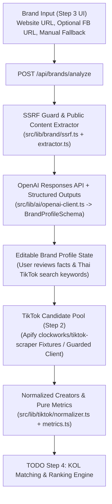

# System Architecture — Convert Cake KOL Matcher

> **Implementation Status:** `Steps 1, 2 & 3 Completed | Step 4 (Matching & Ranking) Pending (TODO)`
>
> - **Step 1:** Next.js App Router scaffold, TypeScript strict mode, ESLint, Prettier, Husky pre-commit hooks.
> - **Step 2:** Apify `clockworks/tiktok-scraper` Zod validation, normalization (`TikTokVideo`, `TikTokCreator`, `CreatorMetrics`), pure metric functions, and fixture loaders.
> - **Step 3:** SSRF-protected website extractor, best-effort Facebook Page extractor, OpenAI Responses API + Structured Outputs (`BrandProfileSchema`), `POST /api/brands/analyze`, and minimal editable Brand Profile UI.
> - **Step 4 (`TODO`):** KOL matching engine, composite ranking, and final influencer recommendation UI.

---

## 1. End-to-End Architecture



---

## 2. Repository Structure

```text
convert-cake-kol-matcher/
├── .husky/
│   └── pre-commit                                  # [IMPLEMENTED] Runs lint-staged (ESLint + Prettier)
├── docs/
│   ├── architecture.md                             # [IMPLEMENTED] System architecture & data flow spec
│   └── evaluation.md                               # [IMPLEMENTED] Scoring & AI evaluation methodology
├── src/
│   ├── app/
│   │   ├── api/
│   │   │   └── brands/
│   │   │       └── analyze/
│   │   │           └── route.ts                    # [IMPLEMENTED] POST /api/brands/analyze
│   │   ├── layout.tsx                              # [IMPLEMENTED] Root App Router layout
│   │   └── page.tsx                                # [IMPLEMENTED] Mounts Step 3 BrandAnalyzerTestBench
│   ├── components/
│   │   └── brand/
│   │       └── BrandAnalyzerTestBench.tsx          # [IMPLEMENTED] Minimal Step 3 test & edit UI
│   ├── data/
│   │   └── fixtures/
│   │       ├── apify-tiktok-raw.json               # [IMPLEMENTED] Real 10-video Apify dataset
│   │       ├── apify-tiktok-raw-batch2.json        # [IMPLEMENTED] Second 10-video Apify batch
│   │       ├── normalized-tiktok-fixture.json      # [IMPLEMENTED] Normalized TikTok fixture
│   │       └── brand-analyzer-fixture.json         # [IMPLEMENTED] Controlled Brand Analyzer fixture
│   └── lib/
│       ├── ai/
│       │   └── openai-client.ts                    # [IMPLEMENTED] OpenAI Responses API + Structured Outputs
│       ├── apify/
│       │   └── tiktok-scraper.ts                   # [IMPLEMENTED] Guarded clockworks/tiktok-scraper client
│       ├── brand/
│       │   ├── analyzer.ts                         # [IMPLEMENTED] Brand analysis orchestrator
│       │   ├── extractor.ts                        # [IMPLEMENTED] Website & Facebook public extractor
│       │   ├── fixtures.ts                         # [IMPLEMENTED] Controlled Brand Analyzer fixture loader
│       │   ├── index.ts                            # [IMPLEMENTED] Barrel export
│       │   ├── schemas.ts                          # [IMPLEMENTED] BrandProfileSchema & API schemas
│       │   └── ssrf.ts                             # [IMPLEMENTED] SSRF & DNS rebinding protection
│       └── tiktok/
│           ├── fixtures.ts                         # [IMPLEMENTED] TikTok fixture loaders
│           ├── index.ts                            # [IMPLEMENTED] Barrel export
│           ├── metrics.ts                          # [IMPLEMENTED] Pure creator metric functions
│           ├── normalizer.ts                       # [IMPLEMENTED] Apify -> TikTokCreator normalizer
│           └── schemas.ts                          # [IMPLEMENTED] Apify & normalized TikTok schemas
└── tests/
    └── unit/
        ├── brand-analyzer.test.ts                  # [IMPLEMENTED] 17 unit tests for Step 3
        └── tiktok-normalizer-metrics.test.ts       # [IMPLEMENTED] 18 unit tests for Step 2
```
