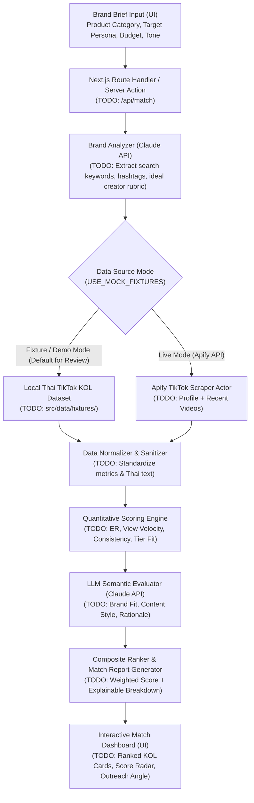

# System Architecture — Convert Cake KOL Matcher

> **Implementation Status:** `Scaffold / Foundation Only`  
> Only repository configuration, Next.js App Router baseline, TypeScript strict mode, linting/formatting, and Husky Git hooks are currently implemented. All AI pipelines, Apify TikTok ingestion, scoring modules, and UI workflows described below are **planned (`TODO`)** for upcoming assessment milestones.

---

## 1. Architectural Overview

`convert-cake-kol-matcher` is designed as a modular, full-stack Next.js (App Router) application tailored for discovering, analyzing, and ranking Thai TikTok Key Opinion Leaders (KOLs) against a brand's campaign profile.

Key architectural goals:

1. **Deterministic + Explainable Hybrid Ranking:** Combine quantitative creator metrics (engagement rate, view consistency, audience scale, posting cadence) with qualitative LLM analysis (content niche alignment, Thai cultural/language fit, brand safety, tone).
2. **Resilient Data Ingestion (Live + Fixture Mode):** Support on-demand TikTok profile and video metadata collection via Apify while providing a deterministic local fixture fallback (`TODO`) for offline evaluation, automated testing, and reviewer inspection without consuming external API credits.
3. **Strict Type & Schema Validation:** Enforce end-to-end TypeScript strict mode and structured JSON schema outputs for all LLM responses (`TODO`).

---

## 2. High-Level Data Flow



---

## 3. Repository Structure (Current vs. Planned)

```text
convert-cake-kol-matcher/
├── .husky/
│   └── pre-commit              # [IMPLEMENTED] Runs lint-staged (ESLint + Prettier)
├── docs/
│   ├── architecture.md         # [IMPLEMENTED] System architecture & data flow spec
│   └── evaluation.md           # [IMPLEMENTED] Scoring & AI evaluation methodology
├── public/                     # [IMPLEMENTED] Static assets
├── src/
│   ├── app/
│   │   ├── layout.tsx          # [IMPLEMENTED] Root App Router layout
│   │   ├── page.tsx            # [IMPLEMENTED] Default Next.js starter page (TODO: Replace with KOL Matcher UI)
│   │   ├── globals.css         # [IMPLEMENTED] Tailwind CSS v4 entry
│   │   └── api/                # [TODO] API route handlers (/api/analyze-brand, /api/discover-kols, /api/match)
│   ├── components/             # [TODO] UI components (BrandForm, KolMatchCard, ScoreBreakdown)
│   ├── lib/
│   │   ├── ai/                 # [TODO] Anthropic Claude client, prompt templates, structured output parsers
│   │   ├── apify/              # [TODO] Apify TikTok actor client, rate-limiting, and response mappers
│   │   ├── scoring/            # [TODO] Quantitative & composite KOL scoring functions
│   │   └── types/              # [TODO] Domain interfaces (BrandBrief, KolProfile, MatchResult)
│   └── data/
│       └── fixtures/           # [TODO] Curated Thai TikTok KOL fixture datasets for demo/offline mode
├── tests/
│   └── README.md               # [IMPLEMENTED] Test directory structure & planned test suites
├── .env.example                # [IMPLEMENTED] Environment variable template
├── eslint.config.mjs           # [IMPLEMENTED] ESLint v9 flat config + Prettier integration
├── next.config.ts              # [IMPLEMENTED] Next.js configuration
├── package.json                # [IMPLEMENTED] Scripts, dependencies, and lint-staged config
└── tsconfig.json               # [IMPLEMENTED] Strict TypeScript configuration
```

---

## 4. Planned Subsystem Specifications (`TODO`)

### 4.1 Brand Analysis Module (`TODO: src/lib/ai/brand-analyzer.ts`)

- **Input:** Raw brand description, product category (e.g., Thai skincare, F&B, fashion, gadgets), target audience demographics, campaign objective (awareness vs. TikTok Shop conversion), and budget tier.
- **Process:** Sends a structured prompt to Anthropic Claude to extract:
  - Target TikTok content pillars and Thai/English search keywords & hashtags.
  - Ideal KOL follower tier (Nano `1K–10K`, Micro `10K–100K`, Macro `100K–1M`, Mega `1M+`).
  - Dynamic category weights for the scoring engine.
- **Status:** `TODO` — Not yet implemented.

### 4.2 TikTok Data Ingestion Layer (`TODO: src/lib/apify/tiktok-client.ts`)

- **Live Adapter (`TODO`):** Integrates with Apify TikTok scrapers using `APIFY_API_TOKEN` to fetch public creator profile metadata (`followers`, `hearts`, `videoCount`, `bio`, `verified`) and recent video performance (`playCount`, `diggCount`, `commentCount`, `shareCount`, `captions`, `hashtags`).
- **Fixture Adapter (`TODO`):** Loads pre-collected, anonymized/public Thai TikTok creator fixtures from `src/data/fixtures/` when `NEXT_PUBLIC_USE_FIXTURES=true` or when `APIFY_API_TOKEN` is omitted.
- **Status:** `TODO` — Not yet implemented.

### 4.3 Hybrid Scoring & Ranking Engine (`TODO: src/lib/scoring/scorer.ts`)

Computes a normalized `0–100` composite match score from four weighted dimensions:

| Dimension                   | Default Weight | Source                  | Description                                                                                                     |
| --------------------------- | -------------- | ----------------------- | --------------------------------------------------------------------------------------------------------------- |
| **Brand & Niche Alignment** | `35%`          | LLM Evaluation (`TODO`) | Semantic relevance between brand brief and creator's bio, captions, hashtags, and content style                 |
| **Engagement Quality**      | `30%`          | Quantitative (`TODO`)   | Median engagement rate `(likes + comments + shares) / views`, comment-to-like ratio, and view-to-follower ratio |
| **Consistency & Momentum**  | `20%`          | Quantitative (`TODO`)   | Posting frequency, low variance between median and mean video views, recent growth signal                       |
| **Audience & Market Fit**   | `15%`          | Hybrid (`TODO`)         | Thai language/market presence, follower tier alignment with campaign budget, brand safety check                 |

- **Status:** `TODO` — Formula and weights defined; code implementation pending.

### 4.4 Explainable Match Report (`TODO: src/lib/ai/match-explainer.ts`)

- Generates human-readable Thai/English reasoning for each ranked KOL:
  - Why this KOL matches the brand ("Match Rationale")
  - Recommended content angle / hook for TikTok ("Campaign Concept")
  - Potential risk factors (e.g., erratic view counts, competitor sponsorships)
- **Status:** `TODO` — Not yet implemented.

---

## 5. Security, Privacy & Reliability Constraints

- **Secrets Management:** `ANTHROPIC_API_KEY` and `APIFY_API_TOKEN` are strictly server-side environment variables and must never be exposed to client bundles via `NEXT_PUBLIC_*`.
- **Public Data Only:** Only public creator metrics and public video captions are processed; no private user data or non-public platform APIs are accessed.
- **Graceful Degradation (`TODO`):** All external API calls will enforce timeouts, structured error boundaries, and automatic fallback to fixture mode when configured.
