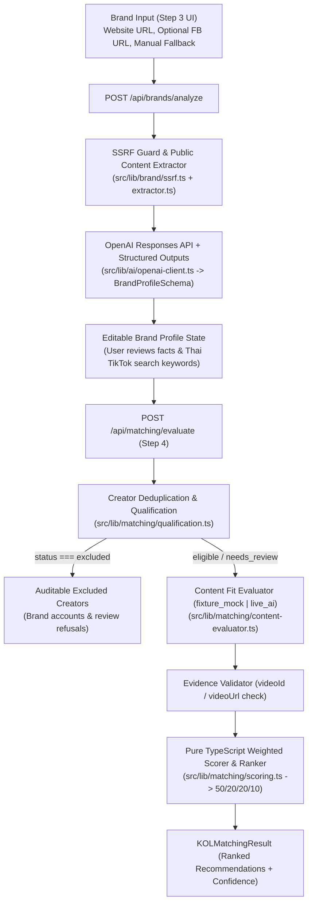

# System Architecture — Convert Cake KOL Matcher

> **Implementation Status:** `Steps 1, 2, 3 & 4 Completed | Step 5 (Final UI Dashboard) Pending (TODO)`
>
> - **Step 1:** Next.js App Router scaffold, TypeScript strict mode, ESLint, Prettier, Husky pre-commit hooks.
> - **Step 2:** Apify `clockworks/tiktok-scraper` Zod validation, normalization (`TikTokVideo`, `TikTokCreator`, `CreatorMetrics`), pure metric functions, and fixture loaders.
> - **Step 3:** SSRF-protected website extractor, best-effort Facebook Page extractor, OpenAI Responses API + Structured Outputs (`BrandProfileSchema`), `POST /api/brands/analyze`, and editable Brand Profile UI.
> - **Step 4:** Deterministic Creator Qualification, OpenAI Content Fit Evaluator with evidence verification, pure TypeScript weighted scoring (`50/20/20/10`), `POST /api/matching/evaluate`, human-labeled benchmark fixture, and minimal matching test UI.
> - **Step 5 (`TODO`):** Final production recommendation dashboard, filtering, and export.

---

## 1. End-to-End Architecture



---

## 2. Repository Structure

```text
convert-cake-kol-matcher/
├── .husky/
│   └── pre-commit                                  # [IMPLEMENTED] Runs lint-staged (ESLint + Prettier)
├── docs/
│   ├── architecture.md                             # [IMPLEMENTED] System architecture & data flow spec
│   └── evaluation.md                               # [IMPLEMENTED] Scoring & benchmark evaluation spec
├── src/
│   ├── app/
│   │   ├── api/
│   │   │   ├── brands/
│   │   │   │   └── analyze/
│   │   │   │       └── route.ts                    # [IMPLEMENTED] POST /api/brands/analyze
│   │   │   └── matching/
│   │   │       └── evaluate/
│   │   │           └── route.ts                    # [IMPLEMENTED] POST /api/matching/evaluate
│   │   ├── layout.tsx                              # [IMPLEMENTED] Root App Router layout
│   │   └── page.tsx                                # [IMPLEMENTED] Mounts Step 3 + Step 4 TestBench
│   ├── components/
│   │   └── brand/
│   │       └── BrandAnalyzerTestBench.tsx          # [IMPLEMENTED] Minimal Step 3 & Step 4 test UI
│   ├── data/
│   │   └── fixtures/
│   │       ├── apify-tiktok-raw.json               # [IMPLEMENTED] Real 10-video Apify dataset
│   │       ├── apify-tiktok-raw-batch2.json        # [IMPLEMENTED] Second 10-video Apify batch
│   │       ├── normalized-tiktok-fixture.json      # [IMPLEMENTED] Normalized TikTok fixture
│   │       ├── brand-analyzer-fixture.json         # [IMPLEMENTED] Controlled Brand Analyzer fixture
│   │       └── kol-matching-fixture.json           # [IMPLEMENTED] Offline test content evaluations
│   └── lib/
│       ├── ai/
│       │   └── openai-client.ts                    # [IMPLEMENTED] OpenAI Responses API + Structured Outputs
│       ├── apify/
│       │   └── tiktok-scraper.ts                   # [IMPLEMENTED] Guarded clockworks/tiktok-scraper client
│       ├── brand/
│       │   ├── analyzer.ts                         # [IMPLEMENTED] Brand analysis orchestrator
│       │   ├── extractor.ts                        # [IMPLEMENTED] Website & Facebook public extractor
│       │   ├── fixtures.ts                         # [IMPLEMENTED] Controlled Brand Analyzer fixture loader
│       │   ├── index.ts                            # [IMPLEMENTED] Barrel export
│       │   ├── schemas.ts                          # [IMPLEMENTED] BrandProfileSchema & API schemas
│       │   └── ssrf.ts                             # [IMPLEMENTED] SSRF & DNS rebinding protection
│       ├── matching/
│       │   ├── content-evaluator.ts                # [IMPLEMENTED] OpenAI Content Fit evaluator & evidence guard
│       │   ├── engine.ts                           # [IMPLEMENTED] End-to-end KOL matching pipeline
│       │   ├── fixtures.ts                         # [IMPLEMENTED] Offline fixture evals & human-labeled cases
│       │   ├── index.ts                            # [IMPLEMENTED] Barrel export
│       │   ├── qualification.ts                    # [IMPLEMENTED] Deterministic creator qualification
│       │   ├── schemas.ts                          # [IMPLEMENTED] Matching & ranking Zod schemas
│       │   └── scoring.ts                          # [IMPLEMENTED] Pure TS scoring, coverage & ranking
│       └── tiktok/
│           ├── fixtures.ts                         # [IMPLEMENTED] TikTok fixture loaders
│           ├── index.ts                            # [IMPLEMENTED] Barrel export
│           ├── metrics.ts                          # [IMPLEMENTED] Pure creator metric functions
│           ├── normalizer.ts                       # [IMPLEMENTED] Apify -> TikTokCreator normalizer
│           └── schemas.ts                          # [IMPLEMENTED] Apify & normalized TikTok schemas
└── tests/
    └── unit/
        ├── brand-analyzer.test.ts                  # [IMPLEMENTED] 17 unit tests for Step 3
        ├── kol-matching-engine.test.ts             # [IMPLEMENTED] 15 unit & benchmark tests for Step 4
        └── tiktok-normalizer-metrics.test.ts       # [IMPLEMENTED] 18 unit tests for Step 2
```
